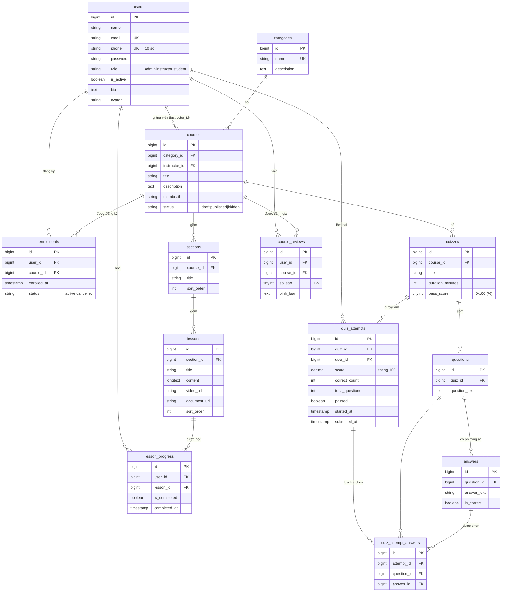

# Sơ đồ ERD và mô tả cơ sở dữ liệu

Hiển thị sơ đồ bằng GitHub, VS Code (extension *Markdown Preview Mermaid Support*) hoặc dán vào <https://mermaid.live>.

Ngoài 13 bảng nghiệp vụ, Laravel dùng thêm các bảng hệ thống: `password_reset_tokens`, `sessions`, `cache`, `cache_locks`, `jobs`, `job_batches`, `failed_jobs`, `migrations`.

## Ràng buộc chính

| Ràng buộc | Mục đích |
|---|---|
| `users.email` UNIQUE | không trùng tài khoản |
| `enrollments (user_id, course_id)` UNIQUE | **ngăn đăng ký trùng** |
| `lesson_progress (user_id, lesson_id)` UNIQUE | mỗi học viên một bản ghi tiến độ cho mỗi bài |
| `quiz_attempt_answers (attempt_id, question_id)` UNIQUE | mỗi câu một lựa chọn trong một lượt làm bài |
| `course_reviews (user_id, course_id)` UNIQUE | mỗi học viên chỉ có một đánh giá cho mỗi khóa học |
| `categories.name` UNIQUE | không trùng danh mục |
| Khóa ngoại `courses.category_id` → `RESTRICT` | không xóa danh mục còn khóa học |
| Các khóa ngoại còn lại → `CASCADE` | xóa khóa học kéo theo chương, bài học, đăng ký, đề thi... |
| `quiz_attempt_answers.answer_id` → `SET NULL` | xóa phương án không làm mất lịch sử làm bài |

Tiến độ khóa học = số bài đã hoàn thành ÷ tổng số bài của khóa học × 100 (làm tròn), tính tại `Course::progressFor()`.
Điểm bài kiểm tra = số câu đúng ÷ tổng số câu × 100; đạt khi `score >= pass_score`.

## Quan hệ N-N

Học viên ↔ Khóa học là quan hệ nhiều-nhiều qua bảng `enrollments` (khai báo bằng `belongsToMany` ở `User::enrolledCourses()` và `Course::students()`).
