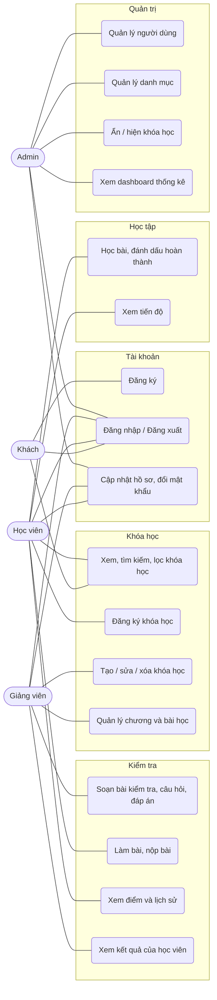

# Phân tích yêu cầu và sơ đồ Use Case

## 1. Tác nhân (Actor)

| Tác nhân | Mô tả |
|---|---|
| Khách | Chưa đăng nhập; xem danh sách/chi tiết khóa học công khai, đăng ký tài khoản, đăng nhập |
| Học viên (Student) | Đăng ký khóa học, học bài, làm bài kiểm tra, xem tiến độ và điểm |
| Giảng viên (Instructor) | Tạo và quản lý khóa học, chương, bài học, bài kiểm tra của mình; xem học viên và kết quả |
| Quản trị viên (Admin) | Quản lý người dùng, danh mục, trạng thái khóa học; xem dashboard thống kê; quản lý mọi khóa học |

## 2. Sơ đồ Use Case (Mermaid — xem trực tiếp trên GitHub hoặc VS Code có plugin Mermaid)

## 3. Đặc tả các use case chính

### UC5 — Đăng ký khóa học
- **Tác nhân:** Học viên. **Tiền điều kiện:** đã đăng nhập; khóa học ở trạng thái công khai.
- **Luồng chính:** mở trang chi tiết → bấm "Đăng ký học" → hệ thống tạo bản ghi `enrollments` → chuyển tới trang học.
- **Ngoại lệ:** đã đăng ký rồi → báo thông tin, không tạo bản ghi thứ hai (kiểm tra ở Controller và unique key `user_id, course_id` ở MySQL); khóa học nháp/ẩn → 404.

### UC8 — Học bài và đánh dấu hoàn thành
- **Tiền điều kiện:** học viên có đăng ký hợp lệ (`status = active`).
- **Luồng chính:** chọn bài trong danh sách chương → xem nội dung/video/tài liệu → bấm "Đánh dấu hoàn thành" → lưu `lesson_progress` → tiến độ = bài hoàn thành / tổng bài × 100%.
- **Ngoại lệ:** chưa đăng ký → 403; bài không thuộc khóa học → 404.

### UC11 — Làm bài kiểm tra
- **Luồng chính:** bấm "Bắt đầu làm bài" → hệ thống tạo `quiz_attempts` (ghi `started_at`) → học viên chọn đáp án, có đồng hồ đếm ngược → nộp bài → hệ thống so sánh từng đáp án với `answers.is_correct`, tính điểm thang 100, so với `pass_score`, lưu `quiz_attempt_answers` → hiển thị kết quả.
- **Ngoại lệ:** nộp lần hai không được tính; nộp quá giờ (sau 60 giây ân hạn) không được chấm; phương án không thuộc đúng câu hỏi bị bỏ qua.

### UC6/UC7/UC10 — Giảng viên quản lý nội dung
- Giảng viên chỉ thao tác trên khóa học có `instructor_id` là mình (kiểm tra bằng `ChinhSachKhoaHoc::quanLy`); Admin được thao tác trên mọi khóa học.
- Giảng viên không tự đặt trạng thái "ẩn" và không công khai lại khóa học bị Admin ẩn.

### UC14–UC17 — Quản trị
- Admin khóa/mở tài khoản (người bị khóa bị đăng xuất ở request kế tiếp), đổi vai trò, xóa người dùng; không thể tự hạ quyền/khóa/xóa chính mình.
- Dashboard: tổng người dùng theo vai trò, số khóa học, lượt đăng ký, lượt nộp bài, điểm trung bình, tỷ lệ đạt, top khóa học, hoạt động gần đây.

## 4. Yêu cầu phi chức năng

- Phân quyền kiểm tra ở phía máy chủ (middleware `role:` + Policy), không chỉ ẩn nút.
- Bảo vệ CSRF, băm mật khẩu, escape nội dung người dùng nhập, validate URL.
- Chạy trên môi trường cá nhân (Laragon: PHP 8.2+, MySQL/MariaDB), cài đặt bằng `composer install` + `php artisan migrate --seed`.
